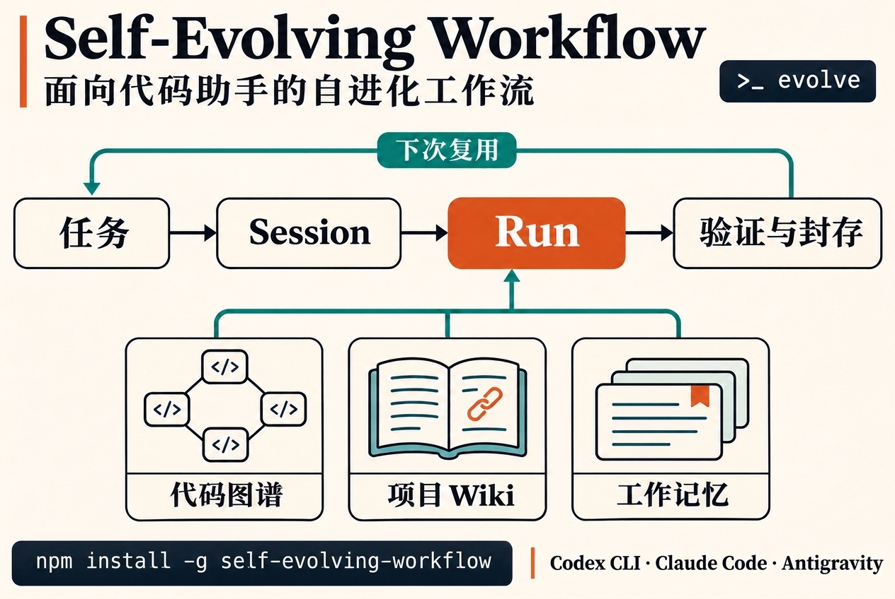
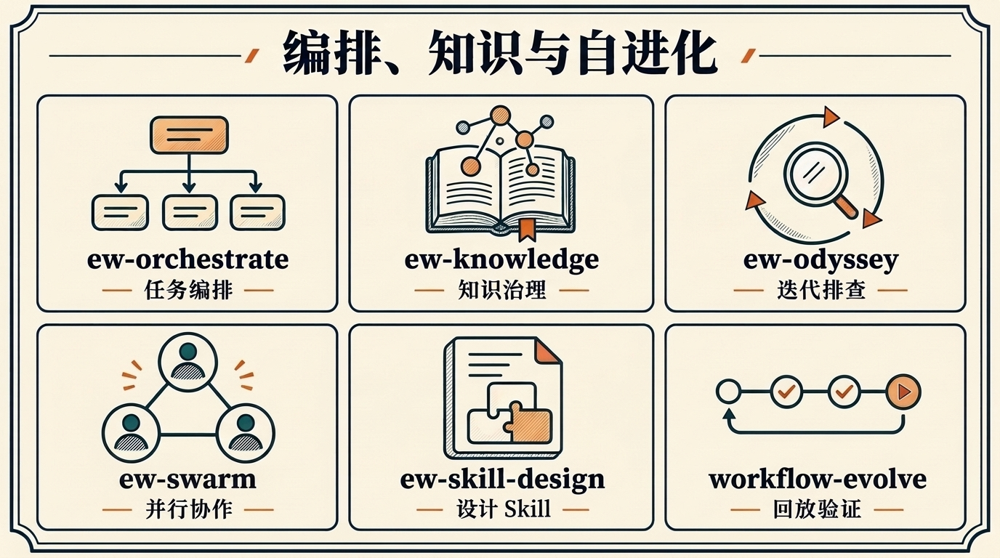
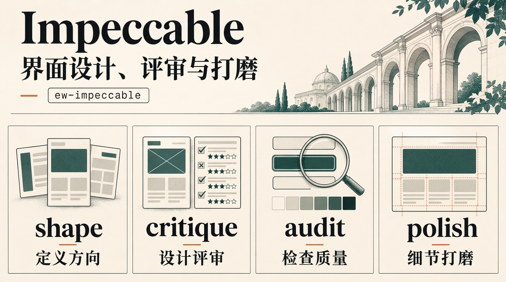

<div align="center">

# Self-Evolving Workflow

面向代码助手的自进化工作流：用可恢复的 **Session / Run** 编排任务，同步本地 **代码图谱 + 项目 Wiki + 工作记忆**，并基于执行证据回放改进 Skill。

[](https://www.npmjs.com/package/self-evolving-workflow)
[](package.json)
[](docs/install.md#2-安装工作流-skill)
[](LICENSE)

[快速开始](#快速开始) · [安装与升级](docs/install.md) · [OMP 安装与委派](#omp-安装与受限委派) · [工作流 Skills](#工作流-skills) · [知识与代码图谱](#知识与代码图谱) · [跨项目经验](#openviking-个人经验库可选) · [Session 与 Run 指南](skills/ew-orchestrate/references/orchestrator-run-loop.md)

</div>



`evolve` 为 Codex CLI、Claude Code、Antigravity、OMP 等代码助手提供可恢复的 **Session / Run 状态机**、自动同步的 **代码图谱 + 项目 Wiki + 工作记忆**，以及依据执行证据提案与回放的 **Skill 自我进化机制**。基础能力默认在本地运行，无需外部服务；需要跨项目复用验证过的经验时，可按仓库选择接入 OpenViking 个人经验库。

## 快速开始

> 需要 `Node.js >= 22.16.0` 和 `Git`。完整宿主目录对照、安装记录与升级/清理用法见 [安装与升级指南](docs/install.md)。

```sh
# 1. 全局安装 CLI
npm install -g self-evolving-workflow

# 2. 在项目根目录安装 Skill（支持 codex / claude / agy / omp / all）
evolve skill install --scope project --host agy --yes

# 3. 写入并验证一条工作记忆
evolve kb add --kind episodic "发布前运行回归测试。" --id quickstart-regression --type work_method --session quickstart
evolve search "回归测试" --mode context --session quickstart
```

升级已有安装并清理已退役旧包可执行 `evolve skill install --upgrade --prune --yes`，查看安装状态可执行 `evolve skill status`。常用会话恢复命令：`evolve session list`、`evolve session get --session <id>`、`evolve run get <run-id> --session <id>`、`evolve run read artifact <run-id> <alias> --session <id>`。

## OMP 安装与受限委派

OMP 与其他宿主一样可安装工作流 Skill；用户级安装命令为 `evolve skill install --scope user --host omp --yes`，写入 `~/.omp/agent/skills/` 与 `~/.omp/agent/AGENTS.md`。

需要独立的只读分析或受控写入时，使用一次性受限进程：

```sh
evolve agent exec "<prompt>" --to omp --mode analysis|write [--role <name>] [--model <selector>] [--timeout <ms>] [--session <id> --run <id>]
```

默认 `analysis` 角色为 `@plan`、`write` 角色为 `@task`；显式 `--model` 优先于 `--role`，角色只选择模型，不进入 Plan 模式、不授予权限。`--timeout` 使用毫秒，默认 `600000`；`OMP_EXECUTABLE` 可覆盖可执行文件。该路径通过 `--trusted-extension` 加载随包 SDK bridge，无额外 OMP npm 依赖，不需要社区沙箱或容器；它是一次性受限 worker，不是托管的 OMP `start`/`send` 会话，也不支持 worktree 或 `--stream`。

严格 `analysis` 仅开放 `read`/`grep`/`glob` 和绑定的 6 个 Run 知识工具，不开放 `bash`/`eval`/`write`/`task` 或环境 MCP；`write` 开放读写工具、`bash`/`lsp` 和绑定知识工具，不覆盖用户审批、不启用 yolo。6 个 Run 知识工具通过共享的进程内执行提供，不启动 MCP 子进程。Codex/OMP 均支持同时传入 `--session`/`--run` 绑定，Agy 保持 standalone，现有 Codex 默认值不变。

该 CLI 委派与 OMP 可安装插件是两个独立入口：委派不加载插件工具，也不要求安装插件；插件打包与进程内工具属于 OMP 插件分支的分发面。原生 OMP `task`/eval `agent()` 的职责或 `tools` 名单不是 OS 权限隔离；第二意见须显式选择获授权模型，同模型子代理不等于独立模型验证。详见 [OMP 宿主适配](skills/ew-orchestrate/SKILL.md#omp-native-delegation-and-strict-cli-analysis)。

### OMP 插件入口

在本分支构建并链接插件；命令行委派与插件互不依赖：

```sh
npm ci
npm run build
omp plugin link /path/to/self-evolving-workflow
```

知识工具在 OMP 进程内运行，不启动 CLI 或 MCP 子进程。`evolve_workflow` 以 `exec` 审批、固定的项目目录和 argv 调用包内 CLI，不经过 shell；需要 PATH 中有 `Node.js >= 22.16.0`，不需要全局 `evolve`。

| 工具 | 使用边界 |
| --- | --- |
| `evolve_wiki_context` / `evolve_memory_search` | 查找并记录当前 OMP 会话使用的知识 |
| `evolve_wiki_reference` / `evolve_memory_get` | 只读取当前有效分支已搜索到的 ID |
| `evolve_read_skill` / `evolve_read_artifact` | 先绑定运行中的 Evolve Run，再读取其固定 Git 版本和已绑定工件 |
| `evolve_run_binding` | 用 `bind` 同时提供 `session`、`run`；用 `unbind` 或 `reset` 清除绑定与搜索资格 |
| `evolve_workflow` | 调用 `session`、`run`（含 `run task`）、`skill`；个人经验仅开放 `experience status/search/get` |

插件不会自动安装 Skills。显式调用 `evolve_workflow`，传入 `{"argv":["skill","install","--scope","project","--yes"]}`，再将项目 `skills/` 与 `AGENTS.md` 提交到 Git。已有副本默认保留，`kept_sources` 会报告路径、版本和包内容哈希。

宿主证据记录在项目 `.evolve/workflow.db` 的独立表（旧项目沿用原有数据库），OMP 会话分支仅保存关联 ID。绑定前的读取不会补记进 Run，同一个 Run 不混用文件回执与进程内回执。OpenViking release 在当前知识范围内固定；配置变更后须先 `reset`，再绑定和搜索。

## 工作流 Skills



| Skill | 适用场景 |
| --- | --- |
| [ew-orchestrate](skills/ew-orchestrate/SKILL.md) | 串行编排初始化、规划、执行、验证与评审，轻量单步任务走内置 `ew-companion`。 |
| [ew-knowledge](skills/ew-knowledge/SKILL.md) | 统一承担 Knowledge Gate 检索、工作记忆同步、收尾沉淀、候选审查与 Wiki 发布/迁移。 |
| [ew-odyssey](skills/ew-odyssey/SKILL.md) | 独立发起的迭代排查（`debug`）、质量提升（`improve`）、多维评审（`review`）、安全/防御审计与 UI 优化。 |
| [ew-swarm](skills/ew-swarm/SKILL.md) | 对复杂或竞争性方案派出多路探索者并行实验、评分筛选与收敛。 |
| [ew-skill-design](skills/ew-skill-design/SKILL.md) | 设计或迁移 Skill，定义输入/输出契约并校验包结构。 |
| [workflow-evolve](skills/workflow-evolve/SKILL.md) | 从执行日志与记忆提取改进草案，经沙盒回放对比后再应用或回滚。 |
| [ew-impeccable](skills/ew-impeccable/SKILL.md) | Web 与原生移动界面的方向制定、评审、审计与打磨。 |

### Impeccable 界面设计



内置 Impeccable 4.9.2 设计手册与引擎（`impeccable.mjs`），核心链路覆盖 `shape`（定义方向）→ `critique`（设计评审）→ `audit`（检查质量）→ `polish`（细节打磨）：

```sh
evolve skill install --scope project --skill ew-impeccable --yes
evolve skill workflows show ew-impeccable
```

## 知识与代码图谱

- **Wiki 与工作记忆**：Run 通过 `evolve search "<query>" --mode context --reads <receipt.json>` 与 `evolve kb get` 读取知识时会生成带校验值的 `knowledge-reads.json` 回执；Wiki 检索索引与工作记忆等本地运行时数据统一收拢在 `.evolve/`，正式 Wiki 落在 `wiki/entries/`（详见 [知识路由](skills/ew-knowledge/references/knowledge-route.md)）。
- **增量代码图谱（`.codegraph/`）**：在 Git 根目录开启 Session 或查询符号时自动建库并按变更增量同步：
  ```sh
  evolve code search "<symbol>"
  evolve code graph "<symbol-id>" --direction callers --depth 2
  evolve code trace "<from-id>" "<to-id>"
  ```
- **多宿主同步与进化**：`evolve kb config --host all` / `evolve kb sync --host all` 同步 Codex CLI、Claude Code 与 Antigravity 会话记忆，再经 `kb harvest` → `skill draft` → `skill replay` → `skill apply` 完成 Skill 迭代。

### OpenViking 个人经验库（可选）

**默认关闭。** 在要采集经验的 Git 仓库根目录运行：

```sh
evolve experience enable    # 复用已有连接，只启用当前仓库
evolve experience status    # collecting: true 表示当前仓库已启用
evolve experience disable   # 只停止当前仓库采集，不删除已发布经验
```

`enable` 使用已有 OpenViking 连接（默认 `~/.openviking/ovcli.conf`；可用绝对路径的 `EVOLVE_OPENVIKING_CONFIG` 覆盖）确认身份，自动创建或更新用户级 `~/.evolve/experience.json`，保留其他仓库的设置。无需手写经验配置、重填 API key，也不依赖项目级 `evolve openviking` 配置。`EVOLVE_EXPERIENCE_CONFIG` 可用绝对路径覆盖经验配置文件，适用于隔离测试。

- **只收有验证证据的经验**：由当前 `ew-test` / `ew-verify` 的 AI 提炼适用条件和验证结果；Session 完成后进本地待审队列，不另调模型。项目需使用并提交包含经验提炼支持的新版 Skills，已有 Run 不换绑。
- **人确认后才共享**：用 `evolve experience pending` 查看待审候选，`evolve experience review <候选ID>` 预览。启用不上传对话、源码或日志；经明确批准后只发布审阅过的经验，重复项补验证来源，冲突不覆盖旧条目。
- **按领域和版本按需查**：例如 `evolve experience search python python@3.12 "异步请求阻塞"`。未启用采集的仓库也能查已发布经验；经验仅作参考，项目规则优先。

详见[配置与检索](skills/ew-knowledge/references/knowledge-route.md#个人跨项目经验可选)和[审阅与发布](skills/ew-knowledge/references/closeout-protocol.md#个人跨项目经验审阅)。

## 迁移与开发

- **从 Maestro Flow 迁移**：`evolve kb import --knowhow-only` 预览，确认后加 `--apply` 写入 Wiki；支持 `--root <target>` 跨项目导入与 `--repository "<UUID>"` 范围检索。
- **源码测试**：`npm ci && npm test` 运行 TypeScript 编译与单元测试；`node test/ew-layout.mjs` 校验 Skill 包结构与链接。

## 致谢与许可

- 工作流设计与代码图谱钩子延续/参考自 [Maestro Flow](https://github.com/catlog22/maestro-flow)（[图谱初始化](https://github.com/catlog22/maestro-flow/blob/master/src/hooks/kg-auto-init.ts) · [图谱同步](https://github.com/catlog22/maestro-flow/blob/master/src/hooks/kg-sync-hook.ts)）。
- 记忆与 Wiki 引擎复用了 [TencentDB Agent Memory](https://github.com/TencentCloud/TencentDB-Agent-Memory/tree/42d4cde50c5a83182fced8c584f9ddb32a620615) 的部分 MIT 实现。
- `ew-impeccable` 保留 Paul Bakaus / Maestro Flow 适配版 Apache-2.0 声明（[来源](skills/ew-impeccable/UPSTREAM.md) · [许可](skills/ew-impeccable/LICENSE) · [说明](skills/ew-impeccable/NOTICE.md)）；其余代码基于 [MIT 许可证](LICENSE) 开源。
